# Weather-Aware Truck Routing

A full-stack decision-support application that compares multiple truck routes
against ETA-specific weather forecasts, applies load-sensitive safety rules, and
recommends the safest eligible route before considering travel time.

The Django REST Framework backend generates and evaluates route candidates. The
Vite/React frontend presents the alternatives on an interactive map with
risk-colored checkpoints, weather details, ranking explanations, and a
time-aware forecast corridor.

> **Safety notice:** This application provides planning support only. Dispatchers
> and drivers remain responsible for following official road closures, carrier
> policies, local regulations, and real-time safety guidance.

## Features

- Accepts an origin, destination, departure time, and load weight.
- Forward-geocodes locations and requests three distinct route candidates from
  Mapbox.
- Samples each route at configurable 25- or 50-mile intervals.
- Calculates checkpoint ETAs from route-segment travel times.
- Retrieves the nearest available OpenWeather hourly forecast for every
  checkpoint ETA.
- Evaluates sustained wind, rain, and snow using a deterministic risk matrix.
- Applies load-sensitive wind overrides for heavy trucks.
- Rejects any route containing a **No Travel** checkpoint.
- Ranks eligible routes using an explicit safety-first hierarchy.
- Returns GeoJSON route geometry, checkpoint forecasts, risk breakdowns, ranking
  metrics, and human-readable selection or rejection reasons.
- Displays all three alternatives in Leaflet with distinct route colors,
  risk-colored checkpoint markers, weather popups, and selected-route heat halos.
- Includes a 0–48 hour trip-corridor control that emphasizes ETA-aligned
  checkpoint forecasts nearest the selected hour.
- Provides responsive loading, cancellation, validation, timeout, and API-error
  states in the React UI.

## System Flow

```mermaid
flowchart LR
    A[React trip form] -->|POST /api/routes/calculate/| B[Django REST Framework]
    B --> C[Mapbox geocoding and directions]
    C --> D[Route checkpoint sampling and ETA interpolation]
    D --> E[OpenWeather hourly forecasts]
    E --> F[Load-aware risk engine]
    F --> G[Safety-first route ranking]
    G --> H[Leaflet map and recommendation panel]
```



## Risk Model

### Weather thresholds

| Risk level | Wind | Rain | Snow |
| --- | ---: | ---: | ---: |
| Low | `< 25 mph` | `< 0.10 in/hr` | `< 0.5 in/hr` |
| Moderate | `25–34 mph` | `0.10–<0.25 in/hr` | `0.5–<1.0 in/hr` |
| High | `35–44 mph` | `0.25–<0.50 in/hr` | `1.0–<2.0 in/hr` |
| Severe | `45–54 mph` | `0.50–1.00 in/hr` | `2.0–3.0 in/hr` |
| No Travel | `≥ 55 mph` | `> 1.00 in/hr` | `> 3.0 in/hr` |

Shared category boundaries enter the higher category, except rain at exactly
`1.00 in/hr` and snow at exactly `3.0 in/hr`, which remain Severe because their
No Travel thresholds use a strict greater-than comparison.

### Load-sensitive wind rules

1. Wind at or above `55 mph` is **No Travel** for every load.
2. Wind from `45–54 mph` with a load of at least `30,000 lb` is **No Travel**.
3. Wind from `35–44 mph` with a load above `40,000 lb` is at least **Severe**.

### Recommendation hierarchy

Eligible routes are compared in this exact order:

1. Fewest Severe miles
2. Fewest High miles
3. Lowest distance-weighted average risk
4. Shortest travel time

Input/provider order is used only when every ranking criterion is tied.

## Tech Stack

| Layer | Technologies |
| --- | --- |
| Backend | Python, Django, Django REST Framework |
| Routing and geocoding | Mapbox Geocoding v6 and Directions v5 |
| Weather | OpenWeather One Call 3.0 |
| Frontend | React, TypeScript, Vite, Axios |
| Styling | Tailwind CSS v4 |
| Mapping | Leaflet and React Leaflet |
| Data format | JSON and GeoJSON `LineString` geometry |

## Repository Structure

```text
outputs/
├── README.md                    # Full-stack documentation
├── routing/                     # Reusable Django application
│   ├── models.py                # Route and Checkpoint models
│   ├── services.py              # Risk thresholds and recommendation engine
│   ├── external_services.py     # Mapbox and OpenWeather clients
│   ├── route_planning.py        # Sampling, enrichment, and orchestration
│   ├── serializers.py           # DRF request and response contracts
│   ├── views.py                 # POST endpoint and error handling
│   ├── urls.py                  # /api/routes/calculate/
│   └── tests/                   # Backend unit and integration-style tests
└── truck-route-frontend/        # Vite/React/TypeScript application
    ├── src/
    │   ├── api/                 # Axios client
    │   ├── components/          # Form, map, slider, and summary UI
    │   ├── types/               # Backend contract types
    │   ├── App.tsx              # Application orchestration
    │   └── styles.css           # Tailwind theme and Leaflet styling
    ├── vite.config.ts
    └── package.json
```

## Prerequisites

- Python 3.10 or newer; Python 3.12 is tested.
- Node.js 20.19 or newer and npm.
- A Mapbox access token.
- An OpenWeather API key with access to One Call 3.0.

## Quickstart

### 1. Configure and run the Django backend

The `routing` directory is a reusable Django app. If a project-level
`manage.py` already exists, place `routing` beside it and skip the
`django-admin startproject` command below.

From the `outputs` directory:

```shell
python -m venv .venv
```

Activate the virtual environment:

```shell
# macOS/Linux
source .venv/bin/activate

# Windows PowerShell
.venv\Scripts\Activate.ps1
```

Install the backend dependencies:

```shell
python -m pip install --upgrade pip
python -m pip install Django djangorestframework django-environ django-cors-headers
```

If needed, create the small project-level Django shell around the existing app:

```shell
django-admin startproject config .
```

Add the applications and local frontend origin to `config/settings.py` after
the default `INSTALLED_APPS` and `MIDDLEWARE` declarations:

```python
import environ

env = environ.Env()
environ.Env.read_env(BASE_DIR / ".env")

INSTALLED_APPS += [
    "corsheaders",
    "rest_framework",
    "routing",
]

# Keep CorsMiddleware before CommonMiddleware.
MIDDLEWARE.insert(0, "corsheaders.middleware.CorsMiddleware")

CORS_ALLOWED_ORIGINS = [
    "http://localhost:5173",
]
```

Include the routing API from the project URL configuration:

```python
# config/urls.py
from django.contrib import admin
from django.urls import include, path

urlpatterns = [
    path("admin/", admin.site.urls),
    path("", include("routing.urls")),
]
```

Create `.env` beside `manage.py`:

```dotenv
MAPBOX_ACCESS_TOKEN=your-mapbox-access-token
OPENWEATHER_API_KEY=your-openweather-api-key

# Optional tuning
ROUTING_MOCK_MODE=auto
MAPBOX_DIRECTIONS_PROFILE=mapbox/driving-traffic
ROUTE_CHECKPOINT_INTERVAL_MILES=50
ROUTE_MAX_CHECKPOINTS=200
EXTERNAL_API_TIMEOUT_SECONDS=15
OPENWEATHER_MAX_FORECAST_GAP_SECONDS=5400
```

Create the database tables and start Django:

```shell
python manage.py makemigrations routing
python manage.py migrate
python manage.py runserver 127.0.0.1:8000
```

The API will be available at:

```text
POST http://127.0.0.1:8000/api/routes/calculate/
```

### 2. Configure and run the React frontend

In a second terminal:

```shell
cd truck-route-frontend
npm install
```

Copy `.env.example` to `.env.local`. The defaults already proxy `/api` to the
local Django server:

```dotenv
# Leave empty when using the Vite development proxy or a same-origin deployment.
VITE_API_BASE_URL=

VITE_DEV_PROXY_TARGET=http://localhost:8000
VITE_API_TIMEOUT_MS=120000
```

Start Vite:

```shell
npm run dev
```

Open `http://localhost:5173`.

## Environment Variables

### Backend

| Variable | Required | Default | Purpose |
| --- | --- | --- | --- |
| `MAPBOX_ACCESS_TOKEN` | For live mode | — | Mapbox geocoding and route generation credential. |
| `MAPBOX_API_KEY` | No | — | Accepted alias for `MAPBOX_ACCESS_TOKEN`. |
| `OPENWEATHER_API_KEY` | For live mode | — | OpenWeather One Call hourly forecast credential. |
| `ROUTING_MOCK_MODE` | No | `auto` | `auto`, `always`, or `never`; controls development fallback behavior. |
| `MAPBOX_DIRECTIONS_PROFILE` | No | `mapbox/driving-traffic` | Mapbox driving profile. |
| `ROUTE_CHECKPOINT_INTERVAL_MILES` | No | `50` | Distance between weather checkpoints. Set to `25` for denser sampling. |
| `ROUTE_MAX_CHECKPOINTS` | No | `200` | Maximum weather checkpoints across one request. |
| `EXTERNAL_API_TIMEOUT_SECONDS` | No | `15` | Timeout for each provider call. |
| `OPENWEATHER_MAX_FORECAST_GAP_SECONDS` | No | `5400` | Maximum acceptable difference between an ETA and forecast timestamp. |
| `MAPBOX_API_BASE_URL` | No | `https://api.mapbox.com` | Mapbox base URL override for a proxy or test stub. |
| `OPENWEATHER_API_BASE_URL` | No | `https://api.openweathermap.org` | OpenWeather base URL override. |

### Frontend

| Variable | Required | Default | Purpose |
| --- | --- | --- | --- |
| `VITE_API_BASE_URL` | No | Same origin | Public base URL of the deployed Django API. |
| `VITE_DEV_PROXY_TARGET` | No | `http://localhost:8000` | Django target used by the Vite development proxy. |
| `VITE_API_TIMEOUT_MS` | No | `120000` | Browser-side Axios timeout for a full route calculation. |

Only variables prefixed with `VITE_` are exposed to browser code. Never place
Mapbox server credentials or the OpenWeather API key in the frontend environment.

### Local mock mode

The backend can run without active provider credentials:

```dotenv
ROUTING_MOCK_MODE=always
```

Use `always` for fully offline UI development. The default `auto` mode returns
deterministic mock routes when Mapbox or OpenWeather credentials are missing or
explicitly rejected. Mock payloads contain three distinct polylines, ETA-based
checkpoints, varied weather risks, a recommendation, and a No Travel rejection.
They are labeled with `data_source: "mock"`, `mock_reason`, and the
`X-Routing-Data-Source: mock` response header.

Set `ROUTING_MOCK_MODE=never` in production to prevent provider problems from
being represented as development data. In `auto` mode, network timeouts and
non-authentication provider failures still return errors; only missing or rejected
credentials trigger the fallback.

## API Example

```http
POST /api/routes/calculate/
Content-Type: application/json

{
  "origin": "Chicago, IL",
  "destination": "Detroit, MI",
  "departure_time": "2026-11-02T08:00:00-06:00",
  "load_weight_lb": 36000
}
```

A successful response contains the resolved locations, three GeoJSON routes,
all ETA-aligned checkpoints, weather and risk breakdowns, ranking metrics,
selection/rejection explanations, and `recommended_route_id`. The recommendation
is `null` when every candidate contains a No Travel checkpoint.

## Verification

Run the backend service tests from `outputs`:

```shell
python -m unittest discover -s routing/tests -v
```

Run frontend type checking and the production build:

```shell
cd truck-route-frontend
npm run typecheck
npm run build
```

The frontend production bundle is written to `truck-route-frontend/dist/`.

## Forecast Slider Semantics

The backend currently returns the forecast selected for each checkpoint's own
ETA. It does not return a separate 49-hour forecast series for every checkpoint.
The 0–48 hour frontend control therefore emphasizes the ETA-aligned checkpoint
readings nearest the selected trip hour; it does not fabricate unavailable
weather measurements.

For a true fixed-location hourly animation, extend the checkpoint response with
an `hourly_forecasts` array and select the matching forecast in the map component.
Weather-provider credentials should remain server-side.
